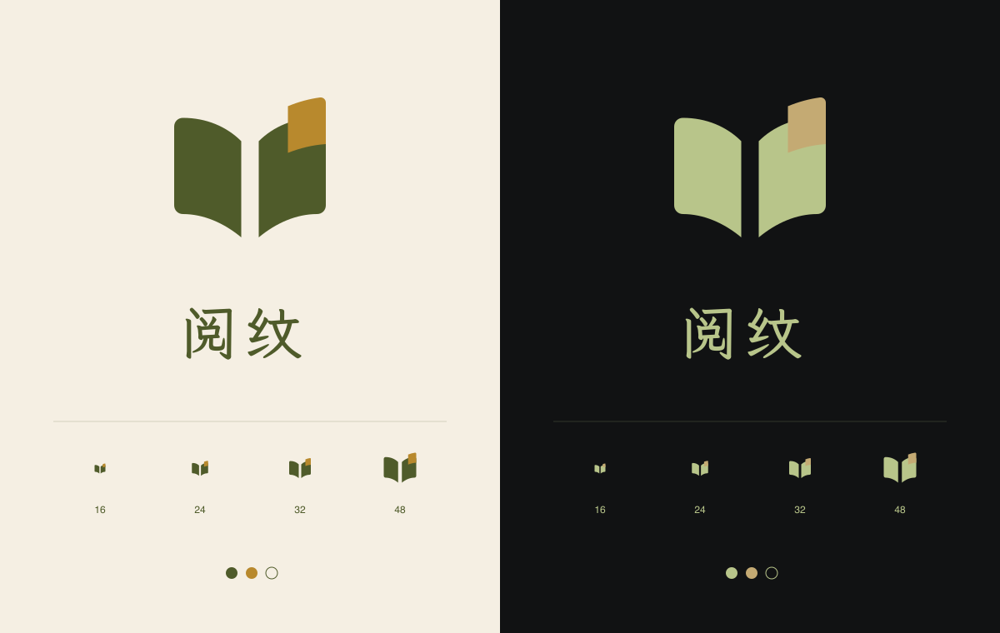

# 阅纹设计规范

版本 1.0 · 2026-10-03

本规范供阅纹的产品、设计与前端开发使用，覆盖桌面端、独立移动端及离线阅读报告。视觉方向为「纸张、书页、阅读留下的纹理」：浅色以纸白和橄榄绿为主，深色以近黑和浅橄榄绿为主，用黄铜金或柔金少量点缀。

本文按当前样式、组件与品牌资产整理。标记为「现状」的内容描述已存在的实现；标记为「新增约定」的内容用于后续设计与开发，尚不代表已完成改造或验收。业务口径以[数据契约](data-contract.md)为准，验证范围见[质量记录](quality-log.md)。

产品设计目标与双端验收边界见[设计计划](plans/design.md)，笔记、图表、作者排行、书架及导航调整与剩余验收见[报告体验计划](plans/report-experience.md)。本规范记录已实施的基线，项目进度统一见[总计划](../PLAN.md)。

## 1 设计方向

阅纹帮助微信读书用户回顾阅读时间、书架、划线与想法。页面应当适合长时间浏览，先帮助用户读懂自己的记录，再提供筛选、探索与下载。

| 场景       | 设计重点                 | 具体做法                                           |
| ---------- | ------------------------ | -------------------------------------------------- |
| 首页       | 让用户理解产品并进入示例 | 大标题、书页插画、明确的主要入口，保留足够留白     |
| 阅读概览   | 快速看懂阅读档案         | 核心指标、时间趋势、阅读画像、书架、选句分层呈现   |
| 深度报告   | 支持比较与追溯           | 统一模块标题、单位、数据范围和明细入口             |
| 书架与笔记 | 便于查找和阅读           | 搜索筛选靠近结果，正文优先，保留书籍与章节来源     |
| 登录与设置 | 让操作结果清楚可预期     | 表单标签明确，错误说明具体，反馈出现在相关操作附近 |

**新增约定：** 报告页面保持规则网格与低强度动效；首页允许书本轻微倾斜、线条与局部不对称。装饰集中在首页、品牌区与选句区，数据区域以文字、细线和留白建立层次。一个操作区域只突出一个主要动作。

## 2 品牌与标志

产品名为「阅纹」，品牌语为「看见你的阅读轨迹」。标志由三道展开的书页线条组成，末页右侧用点缀色强调。

| 用途     | 现有资产或尺寸                                                  | 使用规则                         |
| -------- | --------------------------------------------------------------- | -------------------------------- |
| 浅色图形 | [logo-mark-light.svg](../brand/logo-mark-light.svg)             | 纸白及浅色背景使用               |
| 深色图形 | [logo-mark-dark.svg](../brand/logo-mark-dark.svg)               | 近黑及深色背景使用               |
| 单色图形 | [logo-mark-mono.svg](../brand/logo-mark-mono.svg)               | 单色印刷或受限场景使用           |
| 完整字标 | [浅色](../brand/logo-light.svg)、[深色](../brand/logo-dark.svg) | 独立品牌展示使用，保持图文比例   |
| 桌面页头 | 图形 36 × 29 px，文字 27 px，间距 12 px                         | 图形与文字垂直居中，文字行高为 1 |
| 移动页头 | 图形 29 × 24 px，文字 23 px，间距 9 px                          | 保留紧凑识别，不挤压主题按钮     |

**新增约定：** Logo 周围至少留出图形高度四分之一的净空；不用描边、渐变、投影重新加工标志，不拉伸或改变书页线条的比例。网站使用 `web/public/brand/` 中的发布副本，修改品牌图形时同步 `brand/` 源文件与发布资产。

## 3 配色与语义变量

### 3.1 当前双主题色板

以下颜色取自双端当前 CSS 的有效定义。桌面和移动端变量名不同，但语义相同。

| 语义         | 浅色      | 深色      | 桌面变量             | 移动变量         |
| ------------ | --------- | --------- | -------------------- | ---------------- |
| 页面底色     | `#F5EFE3` | `#111213` | `--background`       | `--paper`        |
| 卡片表面     | `#FAF6ED` | `#1C1E20` | `--surface`          | `--surface`      |
| 正文         | `#4F5B2A` | `#E4E7DA` | `--foreground`       | `--ink`          |
| 品牌主色     | `#4F5B2A` | `#B8C58A` | `--primary`          | `--brand`        |
| 点缀色       | `#B8892D` | `#C4AA73` | `--accent`           | `--accent`       |
| 分隔线与边框 | `#D8C9A8` | `#383B3D` | `--border`           | `--line`         |
| 辅助文字     | `#687048` | `#A9ADAE` | `--muted-foreground` | `--muted`        |
| 次级填充     | `#ECE5D5` | `#272A2D` | `--muted`            | 未统一为独立变量 |

桌面的 `--muted` 表示填充色，移动端的 `--muted` 表示文字色，不能直接按同名变量互换。移动端深色画像和部分底部弹层目前直接使用 `#272A2D`。

### 3.2 颜色使用规则

- 页面使用底色，承载数据的卡片使用表面色；深色弹层允许使用次级填充色增加层次。
- 主色用于主要动作、选中项、关键数字与主数据系列。正文使用正文色，深色主题不把整段文字染成浅橄榄绿。
- 金色用于 Logo 末页、细线、引文和少量图表系列，不作为整页正文或大面积按钮填充。
- 辅助文字承载来源、作者、说明；决定操作的范围、错误原因和重要限制使用正常正文层级。
- 主按钮在主色底上使用页面底色作为文字色，保持现有双主题配对。

**实现注意：** 桌面 Tailwind 的 `bg-accent` 映射到 `--muted`，用于控件交互背景；它不是黄铜金 `--accent`。需要品牌点缀色时应明确引用 `var(--accent)`。移动端通过现有 `--van-*` 映射覆盖 Vant 的按钮、导航、表单、弹层与分隔线。

**新增约定：** 新组件优先引用语义变量，避免再次复制十六进制色值。成功、警告、失败必须同时提供文字或图标说明。当前没有统一的状态色变量，本规范不将品牌金色默认定义为警告色；新增状态色时需同时定义明暗主题并检查可读性。

### 3.3 主题行为

现状为首次访问默认浅色；用户切换后保存到 `yuewen-theme`，下次访问在页面启动时恢复。当前没有「跟随系统」选项。主题切换应同步 Logo、图表、提示框、弹层、输入控件和移动底部导航。

## 4 字体与文字层级

### 4.1 字体

两端共用 `--font-reading`：

`'LXGW WenKai Lite', 'Kaiti SC', 'KaiTi', 'PingFang SC', sans-serif`

现有字体文件只提供 400 与 500 字重，并设置 `font-display: swap` 和 `font-synthesis: none`。部分样式声明了 600，但没有对应的 600 字体文件。**新增约定：** 正文使用 400，强调与标题优先使用 500，通过字号、间距和颜色建立层级，不依赖未提供的字重。

### 4.2 当前字号基线

下表用于延续现有页面。特殊场景另有尺寸，不要求机械地统一所有标题。

| 层级         | 桌面                                  | 移动                         | 使用场景             |
| ------------ | ------------------------------------- | ---------------------------- | -------------------- |
| 首页主标题   | `clamp(54px, 5.7vw, 82px)`，行高 1.28 | 44 px，行高 1.4              | 品牌介绍             |
| 报告页标题   | 36 px，行高 1.4                       | 28 px，行高 1.5              | 当前阅读档案         |
| 区块标题     | 27 px                                 | 22 px，行高 1.5              | 书架、章节、画像     |
| 分析模块标题 | 20 px                                 | 20 px                        | 单张报告卡片         |
| 核心指标     | 46 px，行高 1.3                       | 31 px                        | 时长、天数、条目数   |
| 模块说明     | 13 px，行高 1.8                       | 13 px，行高 1.7              | 图表解释与使用提示   |
| 笔记正文     | 19 px，行高 1.95                      | 17 px，行高 1.9              | 划线、想法           |
| 区间说明     | 16 px                                 | 14 px，行高 1.7              | 实际起止日期         |
| 表单输入     | 16 px                                 | 延续 Vant 表单并使用共享字体 | 邮箱、验证码、Key 等 |

**新增约定：** 功能性正文优先使用 14–16 px，次要说明至少 12 px。已有 9–11 px 的辅助文案列入后续可读性整理，不继续扩展到新功能。界面不再添加装饰性英文眉题，必要技术标识及书名原文保留。

数字比较使用等宽数字特性 `tabular-nums`，数值与单位分层呈现，例如「571.9 小时」。长书名、错误信息和笔记正文允许换行；完整笔记保留原始段落，不能为卡片等高而截断正文。图表轴标签可截短，同时在提示框或明细中提供完整值。

## 5 布局与尺寸

### 5.1 桌面端

桌面常规宽度的主要内容为 `min(1280px, 100% - 112px)`。因此在 1280 px 视口下，内容宽 1168 px、左右各留 56 px；在 1440 px 视口下，内容宽 1280 px、左右各留 80 px。页面不再强制 1280px 最小宽度：低于 1280px 时左右留 24px、概览与分析模块转为单列、书架四列、笔记两栏；低于 768px 时左右留 16px、书架三列、笔记单栏，工具栏和页头允许换行。该收缩布局支持桌面缩放后的操作，独立 Vant 移动入口继续保留。

| 区域         | 当前布局                              |
| ------------ | ------------------------------------- |
| 页头         | 最小高度 102 px，底部细分隔线         |
| 首页首屏     | 两等分栏，间隔 60 px，最小高度 640 px |
| 核心指标     | 四等分横排，指标之间使用竖分隔线      |
| 概览主区域   | 图表与画像按 1.8:1 排列，间隔 24 px   |
| 分析模块     | 两等分栏，间隔 24 px；全年日历跨两列  |
| 书架         | 六列，行间隔 36 px、列间隔 30 px      |
| 书架列表模式 | 两列，每项使用小封面与文字横排        |
| 笔记         | 三栏瀑布流，栏间隔 24 px              |
| 设置         | 内容最大宽度 850 px                   |

### 5.2 移动端

移动端使用独立 `/m/` 入口和 Vant 页面，容器最大宽度 480 px、居中显示。当前没有将桌面页面通过断点变成手机版，也没有专门的平板布局。

| 区域     | 当前布局                                            |
| -------- | --------------------------------------------------- |
| 页头     | 高 60 px，水平内边距 18 px，顶部吸附                |
| 普通页面 | 内边距上下 24 px、左右 20 px                        |
| 首页     | 内边距上 34 px、左右 24 px、下 28 px                |
| 核心指标 | 2 × 2 网格，外侧留白 20 px，单元内边距 18 px        |
| 分析模块 | 单列，左右外边距 16 px、水平内边距 16 px            |
| 书架     | 三列，行间隔 25 px、列间隔 14 px                    |
| 笔记     | 单列，外侧留白 18 px、卡片内边距 20 px              |
| 底部导航 | 基础高度 58 px，叠加安全区域并预留占位              |
| 底部弹层 | 最大宽度 480 px，高度通常不超过视口约 85%，内部滚动 |

新增页面延续「档案、书架、笔记、我的」四个底部入口。深度报告归入档案；首页和登录页隐藏底部导航。只有全年日历、横向书架条等明确设计为横向浏览的区域允许横向滚动，周围提供提示。

### 5.3 间距、圆角与层次

**新增约定：** 新组件以 4 px 为基础，优先选择 4、8、12、16、20、24、32、40、48、64 px。现有 18、21、25 px 等尺寸作为现状保留，不因编写本规范批量改动页面。

| 类型               | 基线                                 |
| ------------------ | ------------------------------------ |
| 图标与文字间距     | 8 px；品牌按专用尺寸                 |
| 同组控件间距       | 8–12 px                              |
| 常规卡片内边距     | 桌面 24 px 左右，移动 16–24 px       |
| 模块间距           | 桌面 24 px，移动 16–24 px            |
| 主要章节间距       | 32–48 px；首页允许更大               |
| 桌面数据卡片       | 直角与 1 px 边框                     |
| 移动数据卡片       | 12 px 圆角；笔记与状态卡片现为 10 px |
| 输入框             | 8 px 圆角                            |
| 主要按钮与章节筛选 | 胶囊形                               |
| 桌面书籍与下载弹窗 | 10 px 圆角                           |

卡片通过底色和细边框分层，阴影主要用于书本插画、封面与弹层。避免给每张数据卡叠加阴影或渐变。

## 6 组件与交互

### 6.1 按钮

桌面复用现有 `Button` 的 `default`、`outline`、`ghost` 三种变体。基础高度至少 44 px、水平内边距 24 px；首页首要动作至少 48 px。移动端使用已映射品牌颜色的 Vant 按钮。

| 状态或用途 | 规范                                                   |
| ---------- | ------------------------------------------------------ |
| 主要动作   | 实心主色，文字使用页面底色，例如「生成阅读档案」       |
| 次要动作   | 描边，例如「探索示例」「下载报告」                     |
| 轻操作     | 透明底或文字链接，例如「查看更多」「停止采集」         |
| 悬停       | 轻微改变透明度或填充，不改变控件尺寸                   |
| 键盘焦点   | 可见的 2 px 焦点轮廓；桌面通常外偏 4 px、移动 3 px     |
| 加载       | 保留动作名称并说明进度，阻止重复提交；已有结果仍可阅读 |
| 禁用       | 明确禁用交互并降低强调，附近说明不可操作原因           |

可点击图标热区至少 44 × 44 px。移动主题与弹层关闭按钮、桌面共享 Dialog 关闭按钮已采用这一尺寸；移动模块“查看更多”入口高度至少 44px。主操作不能只用图标表达；主题、关闭、复制等图标按钮必须有可访问名称。

### 6.2 表单、搜索与筛选

表单有明确标签，提示与错误靠近对应字段。占位文字用于示例输入，不替代标签。提交反馈说明发生了什么以及下一步可以做什么，不显示内部堆栈或原始服务回包。

搜索框靠近结果区域，展示匹配数量和搜索范围。无匹配结果时保留输入内容并提供「清除筛选」。笔记检索注明「仅检索已采集文字」，不能暗示搜索了未取得的全文。

当前桌面基础输入框高 48 px，共享 Select 触发器高度至少 44 px，搜索框使用独立样式。同一工具栏的控件应对齐；其他筛选控件的触达尺寸继续逐项核验。

### 6.3 导航与选中状态

桌面主 tab 保持左侧，统计范围选择、实际日期、来源和采集状态集中在工具栏右侧；未取得报告时也显示目标日期和读取状态，笔记分页未齐时显示补齐状态。采集详情保留停止和重试入口。桌面阅读导航使用文字加 2 px 底部横线表示选中。报告章节筛选使用胶囊形按钮，选中项填充主色。移动底部导航同时显示图标与文字，选中项使用品牌色。

**新增约定：** 路由导航补充 `aria-current="page"`；切换按钮根据交互使用 `aria-pressed` 或对应组件的选中语义。选中状态同时具有形状、线条或文字权重变化，不能只有颜色变化。

### 6.4 报告卡片

卡片标题使用 `h3`，与“查看更多”同排；说明紧随标题，仅在非空时显示，随后为必要范围与图表或数据内容。不重复显示编号和章节 eyebrow，模块 ID 仍保留用于定位。桌面入口打开 Reka UI Dialog，移动入口打开底部弹层。

明细至少提供实际范围、采集覆盖、失败数量、采集时间、来源说明及完整数据表。首页卡片可简化说明，明细中必须保留。部分数据不能只在深层弹窗中才被解释，卡片附近应有可见提示。

偏好卡片直接展示实际周期与起止日；最近 24 月明确显示结束年份、截至日期和「年度偏好，非最近 24 月汇总」，不只放在明细中。

### 6.5 书籍与笔记

封面保持竖向书本比例；桌面现为宽高比 0.68，移动为 2:3。真实图片使用裁切填满，加载失败时使用品牌配色占位封面。书名与作者显示在封面外，不依赖缩小后的封面文字传达信息。书架书名统一保留两行高度并省略溢出，辅助作者文字单行省略；详情显示完整书名。一级分类统一用于筛选和详情，导入书籍显示徽章，缺失出版社和简介不再添加占位，已有元信息继续保留。

书籍详情包括书名、作者、简介、当前进度与相关笔记入口。未知进度使用「未知」，真实 0% 保留为 0%。笔记保留正文、类型、书名、章节与日期；个人想法的关联原文默认完整展开，标为“对应原文”。划线及引用原文用金色下划线强调，保留换行、选择和复制；想法正文不加下划线。页面及导出不显示笔记位置、页码或位置缺失占位，缺章节时省略。演示文字明确标注，不能冒充书中原文。

### 6.6 弹层与反馈

| 场景     | 桌面                            | 移动                           |
| -------- | ------------------------------- | ------------------------------ |
| 书籍详情 | 最大宽度 700 px，封面与文字两栏 | 底部弹层，封面与内容纵向排列   |
| 下载选项 | 最大宽度 530 px                 | 底部弹层，动作纵向排列         |
| 模块明细 | 最大宽度 `min(920px, 90vw)`     | 底部弹层，时间明细优先键值分组 |

弹层显示标题和明确的关闭入口，内容溢出时内部滚动。**新增约定：** 打开后焦点进入弹层，键盘焦点不能落入被遮挡页面；关闭后回到触发控件。移动端还需检查底部安全区和软键盘遮挡。已有组件提供部分支持，完整键盘与读屏流程尚未验收。

复制、下载等短暂结果使用轻量反馈；采集失败、连接异常及需要用户处理的信息保留在页面。不要让重要错误只出现于短暂 Toast。

## 7 图表与数据表达

### 7.1 图表外观

两端共用 `client/charts.ts`，使用 ECharts SVG 渲染和共享阅读字体。常规图表高度为桌面 255 px、移动 260 px；全年日历按年份数量计算高度。图表背景融入卡片，网格线保持轻量。

| 序号 | 浅色系列  | 深色系列  |
| ---- | --------- | --------- |
| 1    | `#4F5B2A` | `#B8C58A` |
| 2    | `#B8892D` | `#C4AA73` |
| 3    | `#8C976A` | `#879B7D` |
| 4    | `#D8C9A8` | `#B7B09B` |

单系列优先使用主色。多系列保持颜色与含义稳定，并提供文字图例或数据表，不依赖颜色独立表达差异。单位保留在数值轴、提示框和明细中，不额外绘制独立的“单位：…”说明。横向柱图的数值轴单位居中放在轴下方并预留底部空间；混合指标各自标注单位。说明只在有统计含义、范围、截断或缺失信息时展示，不留空白占位。雷达的提示列出分类与最多一位小数的相对权重，保留零值、不标百分号；整图区域支持点按，提示限制在容器内。

### 7.2 选型与交互

**新增约定：** 时间趋势优先折线或柱图，排名优先水平条形图，可加总的构成才使用环形图。阅读记录使用日历，多个维度比较可使用已有雷达图；分类权重不是百分比，不能转换成占比文案。

展示 Top N 时明确限制并在明细中保留完整记录。图表点击进入书籍、笔记或月份筛选时，目的页必须显示相应筛选条件；悬停提示不能成为获取关键数据的唯一方式。

作者偏好使用共享列表与 CSS 横条：名称在左、本数在右，下一行显示时长与横条；名称允许换行，横条仅按本数比较，不解析时长。卡片前 5 位与全部返回记录的三列明细分开，缺时长显示“—”；HTML 输出相同的静态列表、横条与明细。

词云使用 `d3-cloud` 碰撞布局和 SVG，全部横排，频次映射为字号；沿用主题色与阅读字体，点按、聚焦或键盘操作可读完整词语和频次。同频字号相同，布局不足时增加高度；超长词在云图省略并明确提示，表格保留原文。离线 HTML 等待字体与布局完成再嵌入 SVG，不需要远程脚本。

全年日历每格对应一天，周一为一周起点，年份分行，保留闰日。当前日历最小宽度 720 px，窄屏在图表区域内滚动，并提示「左右滑动查看全年」。

| 已取得的每日分钟数 | 浅色填充  | 深色填充  |
| ------------------ | --------- | --------- |
| 大于 0，至 30      | `#BBC8A0` | `#536344` |
| 大于 30，至 60     | `#93A66B` | `#728459` |
| 大于 60，至 120    | `#6E8347` | `#95AA70` |
| 大于 120           | `#4F5B2A` | `#B8C58A` |

未阅读、未来、范围外和未取得明细的日期可共用低强调底格，但提示和数据表必须区分真实零值与未知值。日历补齐视觉底格不等于补造阅读记录。

### 7.3 数据状态

| 状态          | 用户看到的内容                 | 可用操作                   |
| ------------- | ------------------------------ | -------------------------- |
| `ready`       | 图表、单位、实际范围           | 查看明细与进一步筛选       |
| `empty`       | 「这个范围内还没有记录」       | 调整范围或清除筛选         |
| `unavailable` | 「当前数据暂不可用」及具体原因 | 数据支持时重试或查看说明   |
| `partial`     | 保留已取得数据，注明覆盖和缺口 | 仅在可重试时显示重试入口   |
| 采集中        | 当前进度，保留已有结果         | 停止采集                   |
| 加载失败      | 简明原因与可执行的下一步       | 根据错误提供重试或重新连接 |

前四项为模块契约状态，后两项为页面或任务状态，不能混作同一个枚举。未知值不显示为 0；不完整月份不标为完整月；书架使用「当前书架」口径，时间统计显示实际日期范围。

模块对 `empty` 与 `unavailable` 有专用占位，并显示已有的 `coverage.reason`；`partial` 模块在保留图表与明细的同时显示“部分覆盖”及已有原因，无具体原因时说明仅展示已采集数据。采集进度与部分覆盖仍保留页面级提示，更多缺失原因随数据采集证据补充。

## 8 文案与反馈语气

品牌区域可以有阅读感，功能区域优先准确。用「下载报告」「清除筛选」「重新连接」等具体动作，保持同一操作在两端的名称一致。

| 场景       | 建议文案                                       |
| ---------- | ---------------------------------------------- |
| 无记录     | 这个范围内还没有记录，可以换一个时间范围。     |
| 无搜索结果 | 没有找到匹配内容。试试其他关键词，或清除筛选。 |
| 部分结果   | 当前展示已取得的数据，部分内容暂未完成。       |
| 数据未知   | 未取得这项数据。                               |
| 下载失败   | 报告生成失败，请重试。                         |
| 示例说明   | 模拟阅读记录；演示文本并非书中原文。           |

日期范围使用明确起止日，展示采集时间时使用 `Asia/Shanghai`。时长的小时、分钟与天数按各自口径显示，不将阅读日均与自然日均混用。阅读画像使用有指标依据的描述，不由词频推断人格、心理状态或健康情况。

## 9 动效与可用性

现有封面悬停为 200 ms 位移过渡，桌面弹窗配置 200 ms 时长，图表入场为 250 ms，采集指示点周期 1.5 秒。**新增约定：** 常规反馈控制在 150–250 ms，主要改变透明度、颜色或轻微位移；布局不因悬停而跳动。

两端 CSS 和共享图表已经考虑 `prefers-reduced-motion`。新增动效必须沿用这一行为，降低动态效果后仍通过文字反馈操作状态。

报告主动导航回到顶部，浏览器前进/后退恢复对应历史条目的筛选、章节和笔记展开数量，再恢复保存位置。报告仍在读取时等待内容与 DOM 更新，后续导航取消旧的恢复；打开浮层、普通筛选和加载更多不额外回顶。历史状态只保存界面控件值，不保存报告正文。

后续界面交付时人工检查：

- 两个主题中，正文、按钮、图表提示与弹层内容都清楚可读；重要信息不只依赖颜色。
- 键盘可到达主要入口、筛选与关闭按钮，焦点始终可见；弹层关闭后回到触发位置。
- 图标按钮有名称，输入控件有标签，错误与状态使用合适的播报语义。
- 字体未加载、书名很长、笔记多段、数据为零或缺失时，内容仍可读。
- 移动端安全区、软键盘及底部导航不遮住主要操作；非横向浏览区域不溢出。
- 200% 缩放时仍能完成核心操作；桌面最小宽度导致的缩放与窄屏问题需要单独验证。

这些是设计验收要求，不是已经通过的测试结论。

## 10 下载与离线报告

当前离线 HTML 固定使用浅色纸张主题，嵌入字体、SVG 图表、数据表、范围与来源说明，不继承浏览器当前深色主题。打印时去掉纸色背景。JSON 用于数据保存，不承担视觉排版。

下载面板说明是否包含已读取的完整笔记；笔记分页尚未补齐时不能开放导出，避免把不完整正文称为完整结果。已结束但采集覆盖不完整的报告可以按数据契约提供部分结果，并明确标注覆盖情况。

下载面板显示当前来源、统计范围与起止日期，并说明月份、单书、分类和搜索等局部筛选不改变整份报告的下载范围。

**新增约定：** 离线报告维持品牌、字号层级和数据语义；不保留无法工作的筛选、悬停依赖或在线跳转控件作为主要阅读路径。

## 11 后续统一事项

以下事项来自当前实现与文档核对；已实施项从待办中移除，验收范围以质量记录为准。

| 优先级 | 已发现的差异                                                                 | 后续处理                                                                 |
| ------ | ---------------------------------------------------------------------------- | ------------------------------------------------------------------------ |
| 高     | README 和质量记录的部分段落仍描述深灰绿；当前 CSS 与品牌预览已使用 `#111213` | 后续更新说明与截图，以本规范的当前色板为基线；旧对比度数值不能用于新色板 |
| 高     | 既有桌面概览截图保留旧字体、模块布局；移动深色截图保留旧灰绿色底             | 截图仅作历史结构参考，下一次视觉验收重新截图                             |
| 高     | 部分辅助文字仍为 9–11 px，其他轻操作的触达尺寸尚未全面核验                   | 桌面 Select、共享 Dialog 关闭和移动模块明细入口已补齐；继续整理剩余控件  |
| 待验收 | 模块 `partial` 卡片级提示已实施，真实部分覆盖样本仍待动态核验                | 核验有数据与提示并存、具体原因及明细、导出口径                           |
| 中     | 字体只提供 400、500，部分样式声明 600                                        | 统一使用已有字重，或单独决定是否补齐字体资产                             |
| 中     | 双端 `--muted` 含义不同，部分深色填充直接写色值                              | 保留当前映射，后续再统一语义命名与变量引用                               |
| 中     | 桌面基础 Dialog 与业务弹窗存在不同遮罩样式；层级使用直接数值                 | 复用现有弹层组件，后续统一遮罩及层级命名                                 |
| 中     | CSS 后部存在同选择器覆盖                                                     | 维护时核对最终生效规则；整理样式属于后续代码任务                         |
| 待验收 | 窄视口与 Chrome 200% 报告导航、作者明细已有局部证据，完整场景仍未完成        | 继续核验平板、全部缩放场景、完整键盘与读屏、物理手机                     |

## 12 维护入口

| 内容                         | 依据                                                                                                                                                                 |
| ---------------------------- | -------------------------------------------------------------------------------------------------------------------------------------------------------------------- |
| 桌面主题、布局与业务组件样式 | [main.css](../web/src/styles/main.css)                                                                                                                               |
| 移动主题、Vant 映射与布局    | [style.css](../web-mobile/src/style.css)                                                                                                                             |
| 共享字体                     | [fonts.css](../client/fonts.css)                                                                                                                                     |
| 主题切换                     | [useTheme.ts](../client/useTheme.ts)                                                                                                                                 |
| 桌面基础组件                 | [Button](../web/src/components/ui/button/Button.vue)、[Input](../web/src/components/ui/input/Input.vue)、[Dialog](../web/src/components/ui/dialog/DialogContent.vue) |
| 模块卡片与数据明细           | [桌面](../web/src/components/ReportModule.vue)、[移动](../web-mobile/src/components/MobileReportModule.vue)                                                          |
| 图表主题与日历               | [charts.ts](../client/charts.ts)、[ReportChart.vue](../client/components/ReportChart.vue)                                                                            |
| 离线报告                     | [export.ts](../client/export.ts)                                                                                                                                     |
| 数据口径与状态               | [数据契约](data-contract.md)、[report.ts](../shared/report.ts)                                                                                                       |
| 品牌资产                     | [品牌预览](../brand/brand-preview.png)                                                                                                                               |

实施新页面时复用当前 Vue、Tailwind、Reka UI、Vant 与 ECharts 体系。本文参考 `antfu-design` 中的语义配色、双主题和克制动效原则，不引入 UnoCSS 配置。修改颜色、字号、组件状态或信息口径时，同步更新本规范对应条目；「新增约定」只有完成实际实现与验证后，才转为现状描述。
